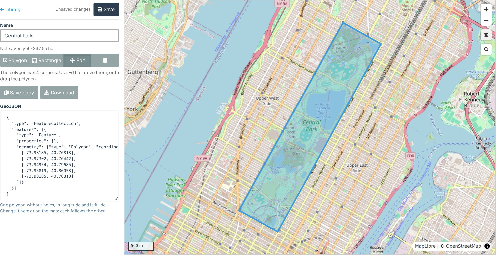

# GeoJSON plugin for WebODM

Draw, import and save polygons for the `boundary` option of a task (Bounds & Cropping), in a library shared by
everyone on the WebODM instance. ODM crops a task's results to the boundary's outline.

## What it does

- **A GeoJSON tab** in WebODM's menu opens the library: every saved boundary on the instance, with its owner,
  area and when it was last changed, searchable by name or owner.
- **An editor for one polygon**, on a map with the instance's basemaps (Administration > Basemaps):
  - draw a polygon or a rectangle, move it or its corners;
  - import a `.geojson` file, or edit the GeoJSON text beside the map (each follows the other);
  - search for an address or a place, with suggestions as you type, or go to "latitude, longitude".
- **Checked as ODM reads it:** one polygon without holes, in longitude and latitude (WGS 84). A file ODM cannot
  use is refused with the reason. Its area is shown in m², ha or km².
- **Shared, with owners:** everyone can see, use, download and copy every file; only its owner and admins can
  rename, change or delete it. Names are unique on the instance, whatever the case.

**In a task's options** (Task Options > Edit), download a boundary from the library and load it with the
`boundary` option's import button.

Coming in 1.1.0: "Create GeoJSON" and "Use existing" buttons beside the `boundary` option, which open the editor
or the library over the task's options. They need WebODM's Task Options hook, proposed in
[WebODM#2041](https://github.com/WebODM/WebODM/pull/2041) and not yet in a release.

## Requirements

WebODM 3.3.2 or later.

## Installing

- From WebODM's plugin directory (Administration > Plugins), once it is listed there; or
- download `geojson-<version>.zip` from this repository's
  [releases](https://github.com/WinuxNomacs/webodm-geojson/releases) and upload it in Administration > Plugins.

WebODM installs the map libraries (MapLibre, terra-draw) with npm when it loads the plugin.

## Data and outside services

- The library is stored in WebODM's database, in the plugin's data store (Administration > Plugin Datum shows
  it). Removing the plugin does not remove it.
- The browser loads map tiles from the instance's basemaps (OpenStreetMap when there are none), and asks
  [Photon](https://photon.komoot.io) for suggestions and
  [Nominatim](https://nominatim.openstreetmap.org) for a search, only when someone types in the map's search.
  The map's last basemap is remembered in the browser.

## Development

The dev environment (WebODM in Docker with the plugin mounted), the tests and the release steps are in
[CLAUDE.md](CLAUDE.md); the plans are in [upcoming-changes.md](upcoming-changes.md).

## License

[GNU Affero General Public License v3.0](LICENSE).
